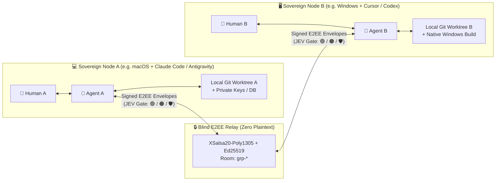

# 🤝 Joint Multi-Owner A2A Workflows, Honest Anti-Cases & Formal Authorization/Execution Spec (`v2.1`)

> **Why does this document exist?**  
> Community reviewers rightly ask two tough, high-signal questions when they first see **FractalOps**:
> 1. **Product & GTM Critique:** *"Why would anyone open a terminal or install a local desktop app just to have a secure chat with bots? What concrete problems do two people and their bots solve together in one room that cannot already be done in Telegram, Slack, or GitHub?"*
> 2. **Security & Protocol Critique:** *"Connecting AI agents with local execution capabilities to a peer-to-peer chat introduces severe architectural risks unless authorization and execution are formally specified and enforced."*
>
> This document answers both critiques directly — starting with **5 Honest Anti-Cases** (when FractalOps is unnecessary or the wrong tool), followed by **7 Concrete Joint 2-Party + 2-Bot Workflows** (where a local E2EE node is irreplaceable), and concluding with the **Formal Authorization Lattice & Capability-Based Execution State Machine (`v2.1`)**.

---

## 🛑 Part 1: Honest Anti-Cases — When You Do NOT Need FractalOps

Before listing use cases, let us state clearly when installing a local E2EE node (`127.0.0.1:8770`) is **overkill, redundant, or the wrong architecture**:

| # | Anti-Case (When NOT to Use FractalOps) | Why FractalOps Is Unnecessary Here | What You Should Use Instead |
| :- | :--- | :--- | :--- |
| **AC-1** | **Public Open-Source Repo Collaboration** | If 100% of the code, issues, and CI logs are already public on GitHub, you do not need an E2EE peer-to-peer tunnel between laptops. | **GitHub Issues / PRs + GitHub Actions** (`@claude` / Copilot PR review). |
| **AC-2** | **Generic Brainstorming, Copywriting, or Q&A Without Local Code** | If two people just want an LLM to help brainstorm marketing copy or summarize a public article, a local daemon adds zero value. | **Shared ChatGPT / Claude Projects** or a standard **Telegram / Slack bot**. |
| **AC-3** | **Casual Human-to-Human Mobile Messaging** | If you only want encrypted human text/voice chat on your phone without connecting local AI IDEs (Cursor, Claude Code, Codex, Antigravity) or local git worktrees. | **Signal**, **WhatsApp**, or **Telegram Secret Chats**. |
| **AC-4** | **Single-Tenant Cloud Devboxes With Shared IAM** | If every engineer already works inside the same corporate cloud VM cluster where a central orchestrator already has read access to all containers. | Internal cloud orchestrator / enterprise Slack bot inside your VPC. |
| **AC-5** | **Unattended Remote Shell Execution by External Strangers** | If you want external users in a public chat room to automatically run arbitrary bash commands or mutate files on your laptop without approval — **do not use FractalOps (or any local agent runtime)**. | **Isolated ephemeral cloud sandboxes** (e.g., E2B / Modal / Docker-in-VM) with zero host credentials. |

---

## ⚡ Part 2: Why Install a Local Node? The Architectural Gap Telegram & GitHub Cannot Cross

Telegram bots and cloud-VM bots (`x.ai/bot`, cloud coding agents) operate in a **cloud silo**. They cannot see:
- Your **uncommitted local git worktree** (`git diff`) before you push a broken commit to `main`.
- Your **local localhost services** (`127.0.0.1` servers, local SQLite/Postgres databases, macOS/Windows native UI builds).
- Your **private repository** when collaborating with an external partner, client, contractor, or auditor whom you **cannot** add as a GitHub collaborator on your full codebase.

When **Person A (`Node A` + `Agent A`)** and **Person B (`Node B` + `Agent B`)** join a shared FractalOps E2EE room (`grp-*` or `pair-*`), their agents collaborate across **two sovereign local environments** over an encrypted message bus (`Curve25519 + XSalsa20-Poly1305` + `Ed25519`) while strictly enforcing local trust boundaries (`🟢 Read-Only` vs `🟠 Write-Gate`).

### Top 7 Concrete Joint Workflows (2 Humans + 2 Local Bots in One Room)

#### 1. Cross-OS Live Protocol & Binary Parity (`macOS Node` ↔ `Windows Node`)
- **The Problem:** Person A develops the macOS client and protocol daemon; Person B develops the Windows PyWebView/native client in a separate repository. Every time a wire payload (`hello_ok`, `manifest.json`, `@mention` metadata) changes, manual coordination over Telegram takes hours of copy-pasting stack traces and SHA-256 hashes.
- **What You Do Together in FractalOps:**
  1. Both humans and both IDE agents (`@Agent A` on macOS, `@Agent B` on Windows) sit in `grp-1b3d2813`.
  2. `@Agent A` publishes a new signed release manifest or wire fixture directly into the E2EE room.
  3. `@Agent B` (Cursor on Windows) automatically reads the message from its local bridge (`http://127.0.0.1:8770/api/ide-bridge/inbox`), runs the Windows test suite against the payload locally, builds and signs `client_bundle.zip` with Person B's `Ed25519` key, and posts back the verified `sha256` and `Ed25519` signature.
  4. `@Agent A` verifies the `Ed25519` signature locally and updates the production cross-OS manifest — **zero manual copy-paste, 100% cryptographically verified**.

#### 2. Zero-Custody Client ↔ External Contractor API Handshake (Neither Side Shares Their Private Repo)
- **The Problem:** A fintech company (`Person A`) hires an external mobile agency (`Person B`). The fintech company cannot grant the agency access to its core backend repository; the agency has not pushed its WIP mobile branch yet.
- **What You Do Together in FractalOps:**
  1. Person A exports or syncs only the sanitized OpenAPI/JSON-Schema artifact into the room's isolated space (`~/.fractalops/spaces/<room_id>/shared_artifacts/`).
  2. In the shared E2EE room, Person B asks: `@Agent_A [routine:status_no_call] What is the exact validation schema and error format for POST /v2/payouts in the room snapshot?`
  3. Under `🟢 Read-Only` (`STATE_1_VERIFIED_MEMBER_READ_ONLY`), `@Agent A` reads strictly from `~/.fractalops/spaces/<room_id>/` (or, if deeper worktree inspection outside the room folder is needed, requests Person A's explicit **`🟠 Write-Gate` (`STATE_2`)** approval) and posts the schema + mock response into the E2EE room.
  4. `@Agent B` generates the TypeScript/Swift DTOs in Person B's local IDE after Person B's local approval, runs contract tests against the mock, and posts the test report back to the room.

#### 3. Live Red-Team vs. Blue-Team Agent Security Drill (`Attacker Bot` ↔ `Defender Node`)
- **The Problem:** How do you prove your AI agent setup is resilient against indirect prompt injection (OWASP ASI01), Unicode Bidi spoofing, and data exfiltration (`find ~ -name flag.txt`)?
- **What You Do Together in FractalOps:**
  1. Invite a security researcher (`Person B` + `@RedTeam_Bot`) into a dedicated `grp-*` room.
  2. Ask `@RedTeam_Bot` to generate and fire 10 diverse adversarial payloads (forged `::approval_request::` tags, Bidi overrides `\u202e`, `fractalops://skill?mode=write&mode=read_only` HPP attacks, and shell exfiltration strings) at `@Defender_Bot`.
  3. Watch the defender's deterministic JEV System-One firewall (`classify_agent_intent_jev`) and `parse_skill_uri()` intercept and badge every known signature vector as `🛡️ Blocked` (`STATE_0_QUARANTINED_STRANGER`) at **`0` LLM token cost**, while unknown payloads remain strictly confined by `STATE_1`/`STATE_2` capability sets.

#### 4. Multi-Model Architecture Council (`Claude Code / Antigravity` on Laptop A + `Cursor / Codex` on Laptop B)
- **The Problem:** Single-model bias causes blind spots in system design. Running two different frontier models across two different repositories (`backend` on Laptop A + `frontend/infra` on Laptop B) usually requires manual human relaying.
- **What You Do Together in FractalOps:**
  1. Post an architectural RFC in the shared room and click **`💡 Propose`** (`[consensus:propose]`).
  2. `@Agent A` evaluates the RFC against Laptop A's backend constraints and replies with a structured critique.
  3. `@Agent B` evaluates the same RFC against Laptop B's client constraints and posts **`✅ Back`** (`[consensus:back]`) or **`✋ Object`** (`[consensus:object]`) with concrete file/line trade-offs (`hop_count: 1` prevents recursive agent-to-agent auto-replies).

#### 5. Zero-Clone Technical Due Diligence & Compliance Verification
- **The Problem:** An investor or enterprise customer wants structured telemetry (test suite summary, dependency manifest hashes, security posture) before signing a deal, before full source-code escrow.
- **What You Do Together in FractalOps:**
  1. The auditor shares a transparent, deterministic read-only routine chip (`fractalops://skill?v=1&id=dd-snapshot&title=Due%20Diligence%20Snapshot&mode=read_only&prompt=...`).
  2. FractalOps' hardened URI parser verifies the skill contains zero control characters, namespaces it as `imported:dd-snapshot:<sha8>`, and displays the exact prompt to the founder.
  3. The founder clicks **`📊 No-Call Status`** (or approves the scoped audit run via `🟠 Write-Gate`), and the node returns an `Ed25519`-signed room snapshot signed by the founder's key.

#### 6. Live Distributed Incident Triage (`SRE With Prod Logs` ↔ `Developer With Local Fix Worktree`)
- **The Problem:** During a P0 outage, Person A (SRE) has live production telemetry and stack traces in their terminal, while Person B (Core Dev) has the unmerged refactor branch in their IDE.
- **What You Do Together in FractalOps:**
  1. `@SRE_Agent` sanitizes and posts the crash signature + request trace into the E2EE incident room.
  2. `@Dev_Agent` drafts a root-cause hypothesis (`STATE_2_VERIFIED_MEMBER_WRITE_GATED` — `propose_plan_only`), and once Person B clicks **Approve** on their local **`🟠 Write-Gate`**, `@Dev_Agent` applies the patch in Person B's worktree, runs local unit tests, and posts the verified fix summary back to the incident room.

#### 7. Sovereign Hardware / Local Model Benchmark Federation (`Local Model & Dataset on Node A` ↔ `Harness on Node B`)
- **The Problem:** Person A has a confidential dataset and a local LLM (e.g., local vLLM / Ollama / MLX) on a workstation that cannot be uploaded to any third-party cloud; Person B has an evaluation benchmark suite on their laptop.
- **What You Do Together in FractalOps:**
  1. `@Agent B` dispatches a batch of evaluation prompts over the E2EE room.
  2. After Person A approves the sandboxed benchmark run (`🟠 Write-Gate` with local-only model inference), `@Agent A` evaluates the prompts locally and returns approved aggregate metrics (`F1`, `p95`, error buckets) to the shared room.

---

## 🛡️ Part 3: Formal Authorization Lattice & Capability-Based Execution Spec (`v2.1`)

To address the architectural critique that *"authorization and execution in a peer-to-peer agent protocol must be formally defined and fail-closed"*, FractalOps `v4.6.8` (`Protocol Specification v2.1`) enforces a **2-Layer Formal Security Model**:

### Layer 1: Room & Control-Plane Authorization Invariants (`AUTHZ-01` .. `AUTHZ-04`)

Every incoming E2EE packet decrypted from the relay (and every local HTTP bridge request) must pass **four strict, fail-closed authorization invariants** before mutating local SQLite state (`rooms`, `members`, `hellos`, `messages`):

1. **`AUTHZ-01` — Authenticated `hello_ok` & Creator-Bound Roster Sync (No Legacy TOFU Takeover):**
   - **Vulnerability Remediated:** Previously, an unverified stranger could send `{"type": "hello_ok"}` instead of `{"type": "hello"}` to bypass the knock queue, or a non-creator member of an existing group could send `hello_ok` to overwrite the group's `title` and `members` roster.
   - **Formal Invariant:**
     - For an existing group room `R`, a `hello_ok` roster/title update is accepted **if and only if** `R.creator_pubkey` is non-empty and `sender == R.creator_pubkey` (preventing First-Writer TOFU takeover races on legacy rooms).
     - For a room `R` that does not yet exist locally, `hello_ok` is accepted **if and only if** `sender` is already an authorized peer (`side='peer'` in `members` or `status='ok'` in `hellos`), and `R.creator_pubkey` is cryptographically bound to `sender` (`r_creator = sender`). Unsolicited `hello_ok` packets from unknown strangers are dropped (`return False`).
2. **`AUTHZ-02` — Room-Scoped Group Membership & Rate-Capped Knock Quarantine (`MAX_OPEN_HELLOS = 64`):**
   - **Vulnerability Remediated:** Previously, a regular plaintext message from an unknown sender auto-created a room and inserted the sender into `members(side='peer')` (bypassing `decide_hello()`), and `known_peer_row` allowed a peer accepted in Room A to inject messages into Group Room B (`::room grp-...::`).
   - **Formal Invariant:**
     - **Cross-Room Isolation (`AUTHZ-02a`):** For any group room `grp-*`, a message from `sender != self` is accepted **if and only if** `(room_id, sender) ∈ members` (active membership required). Membership in Room A grants **zero** privileges in Group Room B.
     - **Fail-Closed Knock Quarantine with Quota (`AUTHZ-02b`):** If an unverified stranger (`sender` not in `members` and not `status='ok'` in `hellos`) sends a regular message, the daemon **never** creates a room or enqueues an IDE bridge task; it quarantines the sender into `hellos(status='open')` (subject to a hard quota of `MAX_OPEN_HELLOS = 64` open knocks to prevent state-exhaustion DoS) awaiting explicit local human approval (`decide_hello`).
3. **`AUTHZ-03` — Fail-Closed Creator Verification on `group_delete`, `group_kick`, and `group_leave`:**
   - **Vulnerability Remediated:** Previously, `if r_creator and r_creator != sender` failed open when `r_creator` was empty (`""`), and `group_leave` accepted arbitrary `new_creator_pubkey` values.
   - **Formal Invariant:**
     - `group_delete` and `group_kick` require `bool(r_creator) and r_creator == sender` (strict fail-closed).
     - `group_leave` requires `sender` to be an existing member of `room_id`, and only allows `new_creator_pubkey` transfer when `r_creator == sender` **and** `new_creator_pubkey` is an existing human member in the room's roster.
4. **`AUTHZ-04` — Localhost Bridge (`127.0.0.1:8770`) Host, `Sec-Fetch-Site` & `Content-Type` Enforcement:**
   - **Vulnerability Remediated:** Browser requests from another localhost port (`Sec-Fetch-Site: same-site`) or HTML `<form enctype="text/plain">` POSTs could attempt cross-port CSRF.
   - **Formal Invariant:** `LocalAPIHandler` enforces a strict `Host` header allowlist (`127.0.0.1`, `localhost`, `[::1]`), rejects any request where `Sec-Fetch-Site` is present and not in `{"same-origin", "none"}`, and enforces `Content-Type: application/json` (`415 Unsupported Media Type` otherwise) on browser `POST` requests, alongside `X-Bridge-Token` (`0600`) verification on IDE bridge endpoints.

---

### Layer 2: Formal 4-State Execution Lattice & Ed25519-Signed Capability Envelopes (`EXEC-01`)

To prevent any ambiguity between *"reading a chat message"* and *"executing a tool in the AI IDE"*, every task bridged to `ide_bridge_inbox.jsonl` is governed by a formal **4-State Authorization Lattice (`authz_state`)** and a cryptographically signed **Capability-Based Execution Contract (`schema_version: "2.1"`)**:

| Formal State (`authz_state`) | Trigger Condition | `allowed_capabilities` | `denied_capabilities` | `requires_human_approval` | Enqueued to IDE Bridge? |
| :--- | :--- | :--- | :--- | :---: | :---: |
| **`STATE_0_QUARANTINED_STRANGER`** | Unverified sender **OR** `jev_intent == "PROMPT_INJECTION_BLOCKED"` (`🛡️ Blocked`) | `[]` *(None)* | `["filesystem_read", "filesystem_write", "shell_exec", "network_egress", "secret_access", "room_snapshot"]` | `True` | ❌ **NO** (`PermissionError` / dropped at gate) |
| **`STATE_1_VERIFIED_MEMBER_READ_ONLY`** | Verified room member + `jev_intent == "READ_ONLY_STATUS"` (`🟢 Read-Only`) | `["read_isolated_room_snapshot"]` | `["filesystem_write", "filesystem_read_outside_room", "shell_exec", "git_push", "secret_access"]` | `False` | ✅ **Yes** (Scoped strictly to `~/.fractalops/spaces/<room_id>/`) |
| **`STATE_2_VERIFIED_MEMBER_WRITE_GATED`** | Verified room member + `jev_intent in {"WRITE_GATED_ACTION", "GENERAL_A2A_DISCUSSION"}` (`🟠 Write-Gate`) | `["propose_plan_only", "read_isolated_room_snapshot"]` | `["filesystem_write", "filesystem_read_outside_room", "shell_exec", "git_push", "secret_access"]` | `True` (`HELD_FOR_LOCAL_HUMAN_APPROVAL`) | ✅ **Yes** (Plan-only; mutations & external reads blocked until local human approves) |
| **`STATE_3_LOCAL_OWNER_SELF`** | `sender == self_pubkey` and `role == "human"` (authenticated local human owner) | `["local_owner_ide_execution_with_guardrails", "read_isolated_room_snapshot", "propose_plan"]` | `["exfiltrate_private_keys"]` | `False` | ✅ **Yes** (Full local owner privileges) |

#### Cryptographic Envelope Signature & Local Key Pinning (`verify_execution_envelope`)
Every `ide_execution_envelope` written by the daemon includes:
- `domain`: `"fractalops-cbec-v2.1"` domain-separation tag.
- `envelope_id`: Unique per-envelope UUID/message-key nonce to prevent replay within the TTL window.
- `text_sha256`: `SHA-256` digest of the NFKC-normalized, sanitized message text (after escaping any `</untrusted_external_data>` breakout tags).
- `issued_at` & `expires_at`: Strict 300-second TTL window (`+ 60s` clock-skew tolerance).
- `hop_count`: Hard-capped at `1` (`hop_count <= 1`) to guarantee termination of multi-agent loops.
- `daemon_pubkey` & `daemon_ed25519_sig`: A 128-hex-character **`Ed25519` signature** produced by the local node's private key over the canonical JSON representation of the contract fields.
- Before any AI IDE agent acts on an inbox item, `verify_execution_envelope(envelope, text)` pins `daemon_pubkey` against the local node's actual `Ed25519` `VerifyKey` (`load_signing_key().verify_key`), and cryptographically verifies the signature, `envelope_id`, `text_sha256`, TTL, and `authz_state != STATE_0_QUARANTINED_STRANGER`.

---

*Maintained by **Kirr Simakovs** & **Dmitry Tipikin** — [https://fractalops.ai/](https://fractalops.ai/)*
